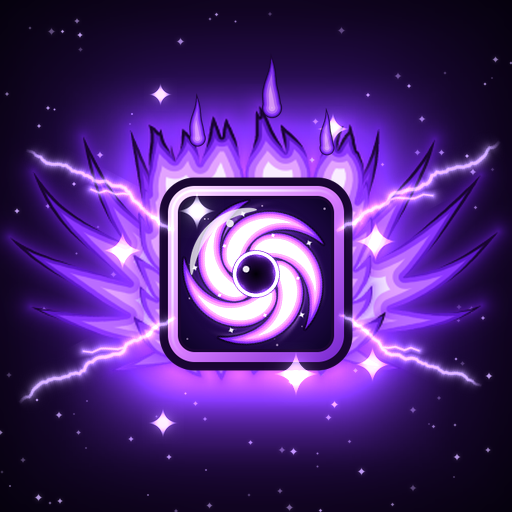
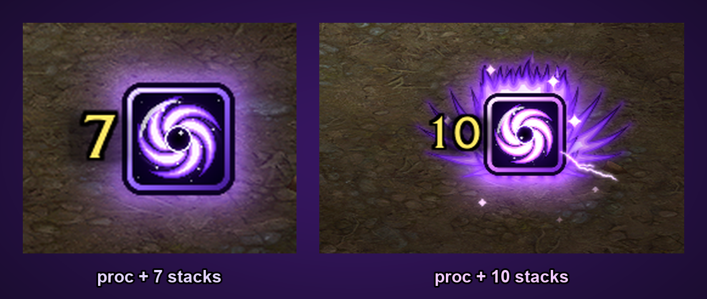
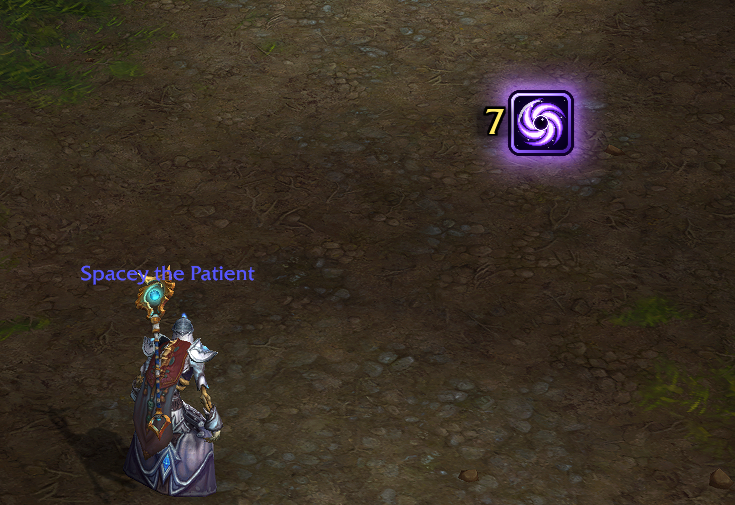
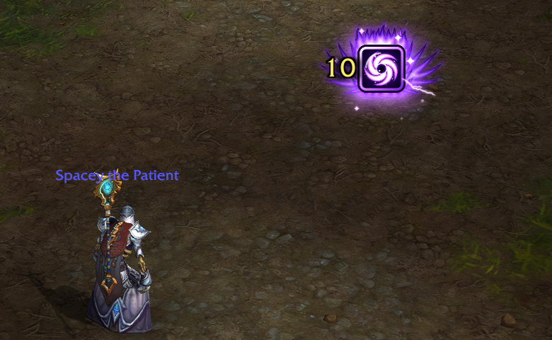
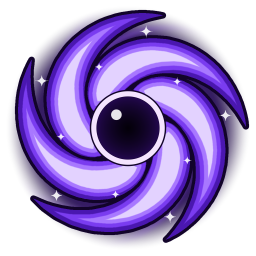
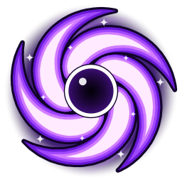
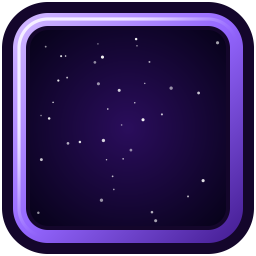
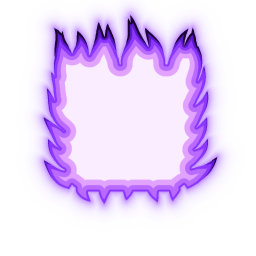

# Void Shield Lite



Tells you when your Void Shield is worth casting: you have a Void Shield proc (Master the
Darkness) AND Weal and Woe is at 7 or more stacks.



```
proc + 7 stacks   : a glowing cartoon void vortex pops up and slowly spins, and one chime
proc + 10 stacks  : it supercharges into a purple phoenix (wings unfurl, violet flames,
                    lightning, sparks, a strong pulsing glow, a shockwave), the vortex spins
                    fast, and a bright music-box run plays
no proc           : no square, no sound (even at 10 stacks)
8 and 9           : silent
```

The stack count sits big on the left edge of the square. It disappears when you cast your
shield. Nothing in the addon runs every frame: the effects are the game's own animations, built
once and only played while the square is showing.
Prefer it calm? `/vsv fx` turns the animations off (the square still glows, brighter at 10).

## In game

| A Void Shield proc + 7 stacks | 10 stacks: maximum power |
| :---: | :---: |
|  |  |

## Soundboard

Each sound pack has two cues: **ready** (your threshold, 7 by default) and **max** (10 stacks).
`/vsv soundboard` lists them; `/vsv soundboard 2` picks one and plays both cues so you can hear it.

```
1. Chimes    cartoon music-box notes rising in G; at 10 a two-octave run into a bright ta-DING
2. Birdsong  real wrens: a sweet whistled call; at 10 a Eurasian wren's sharp, bright song
3. Ocean     sonar ping and echo; at 10 rising pings (G, D, G), dolphins and a whale call
```

The chimes and ocean cues are in G major, and the birdsong call is tuned to sit with them. The max
cue gently fades out the ready cue if it's still ringing. (`/vsv soundpack`, `/vsv sounds` and
`/vsv audio` work too.)

## Install

Download `VoidShieldVortex-<version>.zip` from the
[latest release](https://github.com/rlucas2100/void-shield/releases/latest) (or CurseForge) and
unzip it into `World of Warcraft/_retail_/Interface/AddOns`. You should end up with:

```
Interface/AddOns/VoidShieldVortex/VoidShieldVortex.toc
Interface/AddOns/VoidShieldVortex/VoidShieldLite.lua
Interface/AddOns/VoidShieldVortex/media/...
```

The folder must be called exactly `VoidShieldVortex` (the same as the `.toc` file), or the game
won't load it. GitHub's green "Code > Download ZIP" button gives you the whole project in a
folder called `void-shield-main`, which won't work as an addon: use the release zip, or copy just
the `VoidShieldVortex` folder from inside it.

Then fully restart the game (not just `/reload`): new art and sound files only load at startup.
Your square keeps its position.

## Commands (/vsv or /voidshield)

```
/vsv test        try it: 7 stacks without a proc (nothing), proc (chime), 10 (phoenix), shield
/vsv 7           chime at a proc + 7+ stacks (any number 3 to 10)
/vsv soundboard  list the sound packs    /vsv soundboard 2   pick one and hear it
/vsv fx          the 10-stack phoenix effects on/off
/vsv unlock      drag the square where you want it; Ctrl + mouse wheel resizes. /vsv lock when done
/vsv scale 1.1   set the size directly (0.5 to 4); /vsv scale + or - makes it 0.1 bigger or smaller
/vsv sound       all sounds on/off          /vsv max   the 10-stack sound on/off
/vsv stacks 7    set how many stacks one Penance gives with your current talents
                 (/vsv stacks auto to measure it again)
/vsv status      what it's watching         /vsv debug  print every change in chat
```

## Raids, dungeons and M+

The game hides buffs from addons there (addons can't read the number).

- The number in the square is drawn by the game itself there, so it matches your buff exactly.
- The sounds follow your buff too if the game lets the addon read its own number (`/vsv status`
  inside a key says so). Otherwise they're timed from your Penance bolts, using when your stacks
  really arrive (measured in open-world combat), so a Penance cut short by a dying target only
  counts the stacks you actually got.
- **Void Shield proc**: read from your Power Word: Shield button, which the game turns into Void
  Shield while you hold a proc, whatever gave it to you (Mind Blast, Shadow Word: Pain, Penance).
  With 2 procs it stays Void Shield after you spend one.
- **Weal and Woe**: each Penance adds your stacks (7 by default, or what it measured outside),
  bolt by bolt; Ultimate Penitence fills it to 10 across its barrage; casting a shield uses them
  all up.

First time: get a Void Shield proc and Weal and Woe stacks outside an instance (open world is fine).
That confirms both buffs' spell IDs; `/vsv status` will show "confirmed".

Stacks per Penance (used for the timing of the sounds inside instances): 7 by default. It's
remembered per talent build and switches when you change talents (it says so in chat). It's
measured in open-world combat if it can; or set it yourself with that build loaded: `/vsv stacks N`.

## The art

All drawn for this addon. The `.tga` files in `VoidShieldVortex/media/art/` are what the game uses;
PNG copies are in [`docs/textures/`](docs/textures) so you can see them here. The scripts that
draw the art, render the soundboard and build the release zip are in [`tools/`](tools).

| Void vortex (7+) | Supercharged (10) | Frame | Phoenix wings | Flame crown |
| :---: | :---: | :---: | :---: | :---: |
|  |  |  |  |  |

## Sound credits

The chimes and ocean cues are made for this addon. The Birdsong pack uses two real field
recordings from Wikimedia Commons, both free to use (details in
[`tools/sources/`](tools/sources/README.md)):

- Rufous-naped wren, recorded by Nosferattus (CC0)
- Eurasian wren (*Troglodytes troglodytes*), recorded by Sogning Norway (public domain)

## Author

Made by Orion ([rlucas2100](https://github.com/rlucas2100)).
