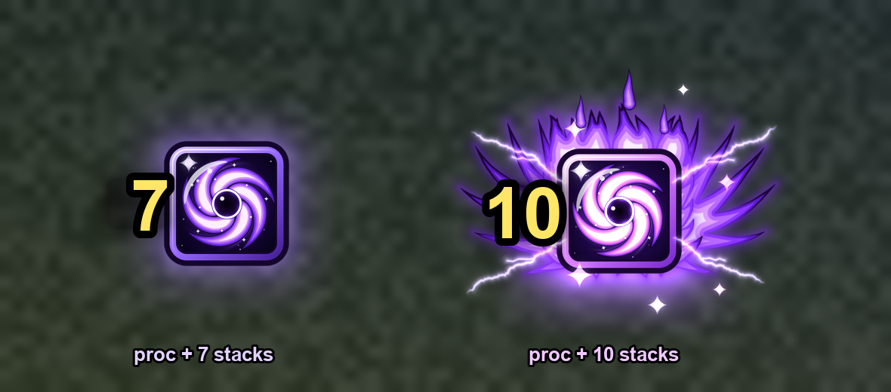

# Void Shield Lite


Tells you when your Void Shield is worth casting: you have a Void Shield proc (Master the
Darkness) AND Weal and Woe is at 7 or more stacks.



```
proc + 7 stacks   : a glowing cartoon void vortex pops up and slowly spins, and one chime
proc + 10 stacks  : it supercharges into a purple phoenix (wings unfurl, violet flames,
                    lightning, sparks, a strong pulsing glow, a shockwave), the vortex spins
                    fast, and the chime cascades upward three times like a jackpot
no proc           : no square, no sound (even at 10 stacks)
8 and 9           : silent
```

The stack count sits big on the left edge of the square. It disappears when you cast your
shield. Nothing in the addon runs every frame: the effects are the game's own animations, built
once and only played while the square is showing.
Prefer it calm? `/vsv fx` turns the animations off (the square still glows, brighter at 10).

## Sound packs

Pick one with `/vsv pack 1`, `2` or `3`. It plays both sounds so you can hear it.

```
1. Chimes    the harp chime; at 10 it cascades up three times into a shower of sparkles
2. Birdsong  a little songbird; at 10 it sings higher and higher into a dawn chorus
3. Ocean     a sonar ping; at 10 rising pings, bubbles, dolphins and a whale call
```

All three are in the same key, so they sit nicely together. The 10-stack sound gently fades out
the 7-stack one if it's still ringing.

## Install

Replace the VoidShieldVortex folder in `World of Warcraft/_retail_/Interface/AddOns` and fully
restart the game (new art and sounds are only loaded at startup). Your square keeps its position.

## Commands (/vsv or /voidshield)

```
/vsv test        try it: 7 stacks without a proc (nothing), proc (chime), 10 (phoenix), shield
/vsv 7           chime at a proc + 7+ stacks (any number 3 to 10)
/vsv pack        list the sound packs    /vsv pack 2   pick one and hear it
/vsv fx          the 10-stack phoenix effects on/off
/vsv unlock      drag the square where you want it; Ctrl + mouse wheel resizes. /vsv lock when done
/vsv scale 1.1   set the size directly (0.5 to 4); /vsv scale + or - makes it 0.1 bigger or smaller
/vsv sound       all sounds on/off          /vsv max   the 10-stack sound on/off
/vsv stacks 7    set how many stacks one Penance gives with your current talents
                 (/vsv stacks auto to measure it again)
/vsv status      what it's watching         /vsv debug  print every change in chat
```

## Raids, dungeons and M+

The game hides buffs from addons there (addons can't read the number).

- The number in the square is drawn by the game itself there, so it matches your buff exactly.
- The sounds follow your buff too if the game lets the addon read its own number (`/vsv status`
  inside a key says so). Otherwise they're timed from your Penance bolts, using when your stacks
  really arrive (measured in open-world combat), so a Penance cut short by a dying target only
  counts the stacks you actually got.
- **Void Shield proc**: read from your Power Word: Shield button, which the game turns into Void
  Shield while you hold a proc, whatever gave it to you (Mind Blast, Shadow Word: Pain, Penance).
  With 2 procs it stays Void Shield after you spend one.
- **Weal and Woe**: each Penance adds your stacks (7 by default, or what it measured outside),
  bolt by bolt; Ultimate Penitence fills it to 10 across its barrage; casting a shield uses them
  all up.

First time: get a Void Shield proc and Weal and Woe stacks outside an instance (open world is fine).
That confirms both buffs' spell IDs; `/vsv status` will show "confirmed".

Stacks per Penance (used for the timing of the sounds inside instances): 7 by default. It's
remembered per talent build and switches when you change talents (it says so in chat). It's
measured in open-world combat if it can; or set it yourself with that build loaded: `/vsv stacks N`.

## The art

All drawn for this addon. The `.tga` files in `media/` are what the game uses; PNG copies are in
[`docs/textures/`](docs/textures) so you can see them here.

| Void vortex (7+) | Supercharged (10) | Frame | Phoenix wings | Flame crown |
| :---: | :---: | :---: | :---: | :---: |
|  |  |  |  |  |

## Author

Made by Orion ([rlucas2100](https://github.com/rlucas2100)).
